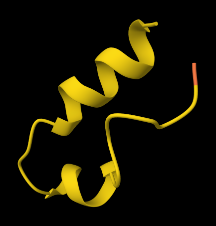
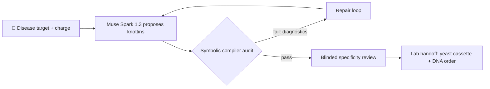

# cozy-peptide — Name the disease. Get a novel AI-designed peptide to treat it.

> ## Try it live: [cozy-peptide.vercel.app](https://cozy-peptide.vercel.app/)
>
> Design a peptide in your browser — no token needed. Then read the
> [biology](https://cozy-peptide.vercel.app/#biology),
> [safety](https://cozy-peptide.vercel.app/#safety), and API tabs on the site.
> This README is the condensed version; the site is the full story.

*Built for the [Meta Global AI Developer
Hackathon](https://cerebralvalley.ai/e/meta-ai-developer-hackathon).*

*Muse Spark invents new peptides. The compiler proves that they're likely to
work. Engineered yeast brews them in your gut.*


## 🎯 Turn a disease name into gut medicine

Most medicines are either tiny chemicals or giant antibodies. cozy-peptide
works in the fertile middle: **knottins** — miniature proteins just 28–36
building blocks long, tied into a molecular knot by six cysteines. That knot
is armor: knottins can survive stomach acid and digestive enzymes that shred
ordinary protein drugs in minutes, so they can act directly inside the gut.

Here is the remarkable part: **no human draws these molecules.** You name a
gut disease target — say, *Clostridioides difficile* colonization — and
**Muse Spark 1.3** invents brand-new knottin sequences from scratch: proteins
that have never existed in nature, reasoned into being from the grammar of
protein language. A deterministic symbolic compiler then interrogates every
candidate — knot topology, charge, stability, protease resistance, safety —
and rejects anything unsound. Failures return as compiler diagnostics that
guide Muse Spark to repair its own designs, in a closed loop, until one
passes every check.

The output is not a picture or a score. It is a **verified protein
sequence** — the invention itself — which converts straightforwardly into a
**DNA synthesis order you can send to a vendor**: codon-optimized cDNA
encoding an engineered living therapeutic in *Saccharomyces boulardii* — a
living miniature factory you install in your gut — that manufactures your
therapeutic on site, exactly where the disease lives. Not a probiotic: a
Live Biotherapeutic Product. The medicine is not a pill you keep taking;
it is a factory you swallow once.

Disease target in, verified protein out — with lab-ready DNA close behind
and a full audit trail anyone can inspect.

## 🧬 Teach AI to write the sentences of life

We think of language models as predictors of words. But words are not the
only language — and arguably not the most important one. The language of
life is written in DNA, translated into amino acids, and strung into
proteins: the molecular machines that digest food, fight infection, and
build bodies. If amino acids are words, proteins are the sentences of
life — and most random sentences are gibberish.

This project teaches Muse Spark 1.3 to write in that language. Science long
ago assigned every amino acid a single-letter abbreviation — A, C, D, E…
— which means a protein is literally a string of text. cozy-peptide adapts
Muse Spark to generate not essays or code, but text-as-amino-acids:
candidate protein sentences, composed under the grammatical constraints of
one of nature's toughest architectures, the knottin.

And just as English has grammar separating sense from nonsense, proteins
have a grammar too — cysteine knots must close, charges must balance,
fragile motifs must be absent. So every AI-written sentence is compiled:
parsed against the knottin loop grammar, audited for stability and safety,
and either accepted or returned with compiler diagnostics for revision.
Muse Spark drafts; the compiler edits; only fluent, grammatical,
manufacturable proteins survive.

A language model that writes valid sentences in the language of life is not
a chatbot trick. It is a drug-discovery engine.

## Change how medicines get made

- **Designed, not discovered.** Drug hunting today means screening libraries
  of molecules found in nature. cozy-peptide flips that: the AI proposes
  truly novel sequences, purpose-built for the target.
- **Language, not brute force.** Instead of simulating billions of atomic
  coordinates, Muse Spark 1.3 treats proteins the way a linguist treats
  sentences — loops as phrases, cysteines as punctuation — and the compiler
  enforces the grammar. Reasoning replaces raw computation.
- **Verified before a dollar is spent.** Every design must pass a battery of
  deterministic checks (topology, charge, hydropathy, liabilities,
  developability metrics) before synthesis is even suggested — and the
  biosecurity filter refuses toxins and out-of-modality enzymes up front.
- **Bench-ready, not demo-ware.** The response includes mature/precursor
  FASTA, restriction-scrubbed cDNA, Gibson assembly arms, CAI/GC reports,
  and a Twist/IDT-compatible order manifest.

## The story in brief

Condensed from the [live site](https://cozy-peptide.vercel.app/) — each
section below is a full tab there.

**cozy-peptide wraps Muse Spark.** A raw model proposes; most proposals
would fail in a real body. Around the model sits a compiler that proves
each design — structure, safety, therapeutic promise — before anything
touches a cell. Four scaffold modalities, from the flagship 6-cysteine
knottin down to simple linear peptides:

```text
name the disease → [ cozy-peptide [ compiler [ Muse Spark ] ] ] → yeast cassette
```

**Biology for everyone.** Chatbots predict the next word; Muse Spark
predicts the next building block of a protein. DNA spells genes with four
letters (A, C, G, T); proteins spell themselves with twenty amino-acid
letters. Swallowed peptides rarely survive stomach acid and pancreatic
proteases — so the winning design never travels as a pill. It is compiled
into DNA and installed as a cassette in *Saccharomyces boulardii*, a
miniature factory living where the disease lives. Full version with market
figures (1 in 10 with IBS, 7M+ with IBD, $33B in drug sales):
[cozy-peptide.vercel.app/#biology](https://cozy-peptide.vercel.app/#biology).

**Safe by design, approved by precedent.** The chassis is GRAS yeast with
decades of safe use; it never colonizes and clears within days of the last
dose; engineered auxotrophy and CRISPR kill switches contain it; and every
peptide passes the compiler first. Regulators already know this category:
Live Biotherapeutic Products go through IND, phased trials, and a full BLA
at the FDA's Center for Biologics — a path Rebyota (2022, first LBP) and
Vowst (2023, first oral LBP) already walked to approval for recurrent *C.
difficile*. Once a chassis-and-compiler platform is proven, a new peptide
is a cassette swap, not a new factory — pointing toward AI-designed,
patient-matched peptides and n-of-1 trials where need is highest (see
milasen, NEJM 2019). Full version:
[cozy-peptide.vercel.app/#safety](https://cozy-peptide.vercel.app/#safety).

## 🔬 Watch a prompt become a protein

<p align="center">
  
</p>

*A never-before-seen mini-protein, invented from scratch by Muse Spark 1.3
to fight **C. difficile** gut infections. Its knotted, ribbon-like shape is
the whole trick: that knot acts as armor, letting the molecule survive
stomach acid and digestive enzymes so it can go to work inside the
intestine. No human drew this molecule and it exists in no natural genome —
it was reasoned into being, then verified, in a single API call.*

*Technical details: proposed by `muse-spark-1.3-contributor` for target
"C. difficile TcdA mucosal colonization" (`charge_target` 4), repaired by
the compiler from the original draft (clearing a Kex2 site, an
N-glycosylation sequon, and an L3 envelope fault), and accepted with
grammar and audit both passing. 28-aa knottin, 6-Cys ICK topology (C1–C4,
C2–C5, C3–C6), formal charge +4, GRAVY -0.061, Boman index 1.075,
aliphatic index 55.36, therapeutic index 83.91, safety index 88.37;
liabilities cleared: trypsin, pepsin, chymotrypsin, Asp-Gly, Asn-Gly,
Met-oxidation. Compiled to an S. boulardii (ATCC MYA-796) MFα1/SLDKR
secretion cassette (CAI 0.9865, restriction scrub clean, 419-bp gBlock,
SB-KNOT-1V315H). Mature sequence:
`CSRTTCSQDTVCKVSKCSVCRIKSVNTC` (also the image filename). Structural
cartoon shown for illustration — verify experimentally before any
therapeutic use.*

## Trace a request from prompt to DNA



1. **Ingestion** — `POST /api/generate-peptide` accepts a therapeutic `target`,
   optional `mechanism`, optional integer `charge_target` (1, 2, 3, or 4),
   optional `modality` (`knottin-6c` default, `disulfide-4c`,
   `disulfide-2c`, or `linear`), and optional `model` (a Meta model id,
   default `muse-spark-1.3-contributor`; `muse-wonder-1.0` also known).
2. **System prompt steering** (`lib/prompt-steering.ts`) — the system infers
   the therapeutic target class (bacterial colonization, toxin blockade,
   barrier repair, inflammation, pain/motility, metabolic, general) and
   authors the brief: per-class design directives plus a non-negotiable
   safety contract, each class aimed at plausible gut molecular targets
   (adhesins and colonization factors, toxin receptor-binding surfaces,
   tight-junction biology, mucosal cytokines, enteric receptors, gut-axis
   metabolic pathways). The caller names the disease; the system engineers
   the rest, threading the advisory `mechanism` note through.
3. **Meta Spark 1.3 sequence proposal** (`lib/meta-spark.ts`) — the Contributor
   API proposes peptide *secretion payloads* for continuous *S. boulardii*
   expression (MFalpha1 pre-pro leader) under the modality grammar
   (knottins: `C1-C4, C2-C5, C3-C6 ICK` topology with canonical loop
   envelopes, anchored by few-shot natural knottins EETI-II and MCoTI-II
   for cysteine pacing).
4. **Deterministic Symbolic Compiler** (`lib/symbolic-auditor.ts`,
   `lib/protein-grammar.ts`, `lib/modality.ts`) — each proposal is audited for:
   - Modality topology: knottin 28-36 aa with **6-Cys parity** and canonical
     **ICK loop envelopes** (L1 3-7, L2 3-6, L3 1-4, L4 2-6, L5 4-10);
     4-Cys 20-36 aa, 2-Cys 12-30 aa with disulfide loop floors; linear
     8-30 aa cysteine-free
   - **Net charge** exactly matching the requested target, inside the
     **+1…+4 window at pH 7.4**
   - **GRAVY** hydropathy inside the modality-calibrated window, plus Boman,
     aliphatic index, pI, mucosal adhesion, cleavage susceptibility, and
     hydrophobic-run metrics
   - **Bioprocess liability filtering** — zero Kex2 sites (`KR|RR|KK|RK`,
     `PR`), zero N-glycosylation sequons (`N[^P][ST]`), zero exposed
     chymotrypsin sites (`[FYW][^P][KR]`), a clean post-Kex2 N-terminus
     (never P/F/Y/W), hydrophobic runs capped at 3 over `[VILMFW]`, at most
     one methionine (oxidation), zero NG deamidation / DG isomerization /
     DP acid-labile hotspots, and no low-complexity dominance (single
     residue at most 40%)
   - **Therapeutic and safety indices** (0-100, `lib/therapeutic-index.ts`) —
     deterministic composites of protease resistance, charge and solubility
     balance, binding potential, mucosal dwell, chemical stability,
     aggregation margin, and membrane selectivity — with the therapeutic
     weights tuned per inferred target class — reported per candidate and
     used to rank passing pools
5. **Closed-loop compiler diagnostic feedback** — failures return structured
   diagnostics with machine-readable failure modes (`KEX2_SITE_DETECTED`,
   `CHARGE_OUT_OF_BOUNDS`, `DEAMIDATION_HOTSPOT`, …) plus recurring-fault
   steering (whatever keeps failing gets fixed first) to the proposer for
   repair at a penalized temperature; the loop runs until a candidate passes
   or turns are exhausted. Passing pools keep their best candidate by GRAVY
   centrality, cleavage index, and therapeutic/safety indices, not
   first-pass order.
6. **Round-trip specificity review** (`lib/specificity.ts`,
   `lib/gut-targets.ts`) — before acceptance, the top candidate goes back
   to Muse Spark 1.3 *blinded*, which must independently rank the intended
   target first and flag no high-risk off-targets (hERG, human ion
   channels, hemolysis, clotting). Predictions pointing at distant organs
   fail like any high-risk flag, and every verdict carries a
   gut-plausibility score. Mismatches trigger revision; the verdict ships
   in the response.
7. **Lab handoff** (`lib/lab-handoff.ts`, `lib/codon-optimizer.ts`) — verified
   candidates are compiled for *S. boulardii* (ATCC MYA-796) with:
   - A ready-to-clone **`cloning_payload`** cassette:
     `MFalpha1-Kex2-Knottin-CYC1term` — 255-nt MFalpha1 5′ flank with the
     Kex2 junction, GC-tuned payload CDS (38-45% GC, rare codons avoided),
     dual stop codons, and the 250-bp CYC1 terminator, verified free of
     BsaI/BsmBI/EcoRI/NotI/XhoI for direct plasmid assembly
   - A Gibson-flanked **gBlock manifest** (85-aa MFalpha-1 pre-pro leader,
     40-bp pESC/pPic9 homology arms) with CAI/GC reporting, mature/precursor
     FASTA, and a DNA synthesis order form
   - A **synthesis-difficulty report** (homopolymer runs, GC-extreme
     windows, repeat flags, 0-100 score) and a vendor-ready **order CSV**
     for Twist/IDT-style uploads — built for synbio and CRO handoff
8. **Agentic tool stubs** (`lib/agent-tools.ts`) — every accepted candidate
   runs through the tool registry (`binding-affinity`, `structure-fold`,
   `off-target-panel`), reported as `agent_tools` in the response. All
   three are honest `not-configured` stubs today: the seam is ready for
   docking, folding, and panel backends, and wiring one means replacing a
   single `invoke` implementation.

## 🛡️ Block toxins and enzymes before generation

`lib/biosecurity.ts` screens every request before generation:

- **Strict toxin-signature screening** — requests matching ricin, abrin,
  botulinum/BoNT (including translocation-domain constructs), diphtheria,
  Shiga, anthrax, tetanus, saxitoxin, tetrodotoxin, aflatoxin, or T-2 toxin
  patterns are refused with `403 Forbidden`.
- **Gut-target filter** (`lib/gut-targets.ts`) — targets naming distant
  organs with no gut relationship (brain, lung, heart, kidney, skin, and
  similar) are refused with `422 Unprocessable`: gut-secreted peptides can
  only plausibly treat what the lumen reaches. Anything with a stated gut
  or gut-axis relationship passes to steering instead.
- **Catalytic-enzyme refusal** — enzyme targets (lactase, polymerase, kinase,
  protease, catalytic triads/pockets, enzyme replacement, and related terms)
  or requests implying folds **>45 aa** are refused with `422 Unprocessable`,
  since catalytic pockets require large globular folds outside the 8-36 aa
  short-peptide modalities. The response suggests sourcing a natural homolog
  instead.

## Generate a peptide in one API call

### `POST /api/generate-peptide`

Requires **Bearer token** authentication. The server compares the
`Authorization` header against the `API_BEARER_TOKEN` environment variable.

```bash
curl -X POST http://localhost:3000/api/generate-peptide \
  -H "Content-Type: application/json" \
  -H "Authorization: Bearer $API_BEARER_TOKEN" \
  -d '{
    "target": "Clostridioides difficile colonization in the gut",
    "mechanism": "Cationic knottin that disrupts vegetative cell membranes while remaining stable to gut proteases",
    "charge_target": 4,
    "modality": "knottin-6c",
    "model": "muse-spark-1.3-contributor"
  }'
```

Sample payload:

```json
{
  "target": "Clostridioides difficile colonization in the gut",
  "mechanism": "Cationic knottin that disrupts vegetative cell membranes while remaining stable to gut proteases",
  "charge_target": 4,
  "modality": "knottin-6c",
  "model": "muse-spark-1.3-contributor"
}
```

Sample JSON response (truncated):

```json
{
  "success": true,
  "target": "Clostridioides difficile colonization in the gut",
  "modality": "engineered_knottin_microprotein",
  "neurosymbolic_provenance": {
    "proposer_model": "Meta-Spark-1.3-Contributor",
    "linguistic_paradigm": "context_sensitive_loop_grammar",
    "compiler_refinement_cycles": 2,
    "refinement_trace": []
  },
  "candidate": {
    "id": "SB-KNOT-1G97R3",
    "sequence": "CNRPNAGQCSLLKNNCIVPCKTCRIHPHWIYYTC",
    "length": 34,
    "cysteine_indices": [0, 8, 15, 19, 22, 33],
    "loop_segments": ["NRPNAGQ", "SLLKNN", "IVP", "KT", "RIHPHWIYYT"],
    "biophysical_profile": {
      "net_charge_ph74": 3.715,
      "isoelectric_point": 8.94,
      "gravy_score": -0.279,
      "boman_index": 1.16
    },
    "cloning_payload": {
      "cassette_format": "MFalpha1-Kex2-Knottin-CYC1term",
      "dna_sequence": "...",
      "gc_percent_cds": 38.2,
      "...": "..."
    },
    "verification_report": {
      "kex2_clean": true,
      "glycosylation_clean": true,
      "charge_window_ok": true,
      "protease_clean": true,
      "passed": true,
      "...": "..."
    },
    "topology": "C1-C4, C2-C5, C3-C6 ICK"
  },
  "symbolic_audit": {
    "passed": true,
    "length": 34,
    "cys_count": 6,
    "charge": 4,
    "charge_target": 4,
    "gravy": -0.279,
    "liabilities_cleared": ["Trypsin", "Kex2-site", "Chymotrypsin", "..."],
    "violations": []
  },
  "specificity": {
    "checked": true,
    "pass": true,
    "predicted_targets": ["C. difficile TcdA receptor", "..."],
    "off_targets": []
  },
  "lab_handoff": {
    "yeast_chassis": "Saccharomyces boulardii (ATCC MYA-796)",
    "secretion_leader": "MF-alpha-1 (85 aa) + Kex2 (KR)",
    "cai": 0.87,
    "gc_content": 0.41,
    "restriction_scrub": { "status": "clean", "sites_verified": [] }
  }
}
```

| Code | Meaning |
| ---- | ------- |
| `200` | Verified candidate with audit ledger and lab handoff. |
| `400` | Invalid JSON body or schema validation failure. |
| `401` | Missing or invalid bearer token. |
| `403` | Biosecurity block (toxin-signature screening). |
| `422` | Catalytic-enzyme or off-site (non-gut) target refusal. |
| `502` | Generation failure; no verifiable candidate produced. |

### More endpoints

- **`POST /api/audit-peptide`** (Bearer [REDACTED] — audit a caller-supplied
  sequence with no model calls: `{sequence, charge_target?, modality?}`
  returns grammar validity, the full violation list, therapeutic/safety
  indices, the verification report, and machine-readable failure modes.
  Built for CRO pre-screening of candidate peptides.
- **`GET /api/modalities`** (public, no token) — lists the compiler's design
  modalities with length windows, cysteine rules, and hydropathy windows.

### Try it in the browser

The landing page includes a live demo that runs the real pipeline with no
token required. It is restricted to five preset gut conditions and one
design per minute per visitor (server-enforced cooldown), so the shared
demo stays responsive and the upstream budget stays intact. While a design
runs, the page streams live pipeline telemetry — proposal, grammar and
audit verdicts per candidate, repair cycles, and handoff — over
`POST /api/demo-stream`.

## Run the compiler locally

Prerequisites: Node.js 20+ and npm.

```bash
npm install

# Required env vars (see .env.local for local values)
export API_BEARER_TOKEN="your-local-bearer-token"
export META_API_KEY="your-meta-spark-key"
# Optional: override the default Meta Spark Contributor endpoint
# export META_SPARK_API_URL="https://api.example.com/v1"

npm run dev      # start Next.js dev server at http://localhost:3000
npm test         # typecheck + node --test suite
npm run lint     # eslint
npm run build    # production build
```

## License

All rights reserved. This is hackathon software: verify all generated
sequences experimentally before any therapeutic or clinical use.

## 🧪 Why this could actually work — a note for skeptics

Let's be honest: an AI best known for writing text, inventing new medicines?
That should sound implausible. It stops sounding implausible once you look
at what these models trained on.

**1. Protein sequences are text, and the training data is full of them.**
Public databases like UniProtKB hold hundreds of millions of annotated
protein sequences — amino-acid strings paired with functions, structures,
and literature — and metagenomic troves hold billions more. Add decades of
papers and patents, and a frontier-scale model has effectively "read" more
protein sequences than any human ever will. To a language model, a knottin
sequence is not chemistry homework; it is a sentence in a language it has
seen countless times. [1]

**2. Models trained this way demonstrably learn protein biology.** Meta's
ESM-1b showed that structure and function *emerge* from scaling unsupervised
learning over 250 million sequences, and ESMFold showed atomic-level
structure can be read straight out of a language model's representations.
The model isn't memorizing — it internalizes the statistical grammar
linking sequence to fold to function. AlphaFold proved the same mapping
from the other direction: sequence determines structure, predictably, at
scale. [2][3][4]

**3. Generative models have already invented working proteins.** Salesforce's
ProGen used next-token prediction — the same mechanism as a chatbot — to
generate artificial proteins with predictable function across families,
including experimentally tested examples. ProtGPT2, a GPT-style model
trained on UniRef50, designs de novo sequences that fold stably. AI-written,
functional, never-before-seen proteins are published, peer-reviewed fact —
not speculation. [5][6]

**4. Knottins are an ideal dialect for an AI to speak.** Short (28–36
residues), rigidly grammatical (six cysteines in the inhibitor cystine knot
topology defined in 1994 [7]), and enormously exemplified in nature —
spider, cone snail, plant, and insect peptides by the thousands. A short,
rule-governed, data-rich format is exactly where generative models shine —
and exactly what a strict compiler can verify.

**5. Generation is cheap; verification is strict.** The crucial asymmetry:
Muse Spark doesn't need to be right every time. It needs to propose
plausible candidates while the deterministic compiler — grammar, charge,
hydropathy, liabilities, developability — rejects everything unsound and
coaches repairs. Even modest hit rates compound into verified designs,
because only fluent sentences survive.

**Honest caveats.** Compiler-verified is not wet-lab-validated: binding,
efficacy, immunogenicity, and manufacturability still require experiments.
What this pipeline claims is narrower and checkable — that every emitted
sequence satisfies explicit biophysical rules — and the refinement trace
shows its work. Incredulity is welcome; that is what the audit ledger is
for.

### References

1. The UniProt Consortium. UniProt: the Universal Protein Knowledgebase in
   2023. *Nucleic Acids Research* 51(D1), D523–D531 (2023).
   Publication: <https://academic.oup.com/nar/article/51/D1/D523/6835362>
   · DOI: <https://doi.org/10.1093/nar/gkac1052>
2. Rives A. et al. Biological structure and function emerge from scaling
   unsupervised learning to 250 million protein sequences. *PNAS* 118(15),
   e2016239118 (2021).
   Publication: <https://www.pnas.org/doi/full/10.1073/pnas.2016239118>
   · DOI: <https://doi.org/10.1073/pnas.2016239118>
3. Lin Z. et al. Evolutionary-scale prediction of atomic-level protein
   structure with a language model. *Science* 379(6637) (2023).
   Publication: <https://www.science.org/doi/10.1126/science.ade2574>
   · DOI: <https://doi.org/10.1126/science.ade2574>
4. Jumper J. et al. Highly accurate protein structure prediction with
   AlphaFold. *Nature* 596, 583–589 (2021).
   Publication: <https://www.nature.com/articles/s41586-021-03819-2>
   · DOI: <https://doi.org/10.1038/s41586-021-03819-2>
5. Madani A. et al. Large language models generate functional protein
   sequences across diverse families. *Nature Biotechnology* (2023).
   Publication: <https://www.nature.com/articles/s41587-022-01618-2>
   · DOI: <https://doi.org/10.1038/s41587-022-01618-2>
6. Ferruz N. et al. ProtGPT2 is a deep unsupervised language model for
   protein design. *Nature Communications* 13, 4348 (2022).
   Publication: <https://www.nature.com/articles/s41467-022-32007-7>
   · DOI: <https://doi.org/10.1038/s41467-022-32007-7>
7. Pallaghy P. K. et al. A common structural motif incorporating a cystine
   knot and a triple-stranded β-sheet in toxic and inhibitory polypeptides.
   *Protein Science* 3, 1833–1839 (1994).
   Publication: <https://onlinelibrary.wiley.com/doi/10.1002/pro.5560031022>
   · DOI: <https://doi.org/10.1002/pro.5560031022>
